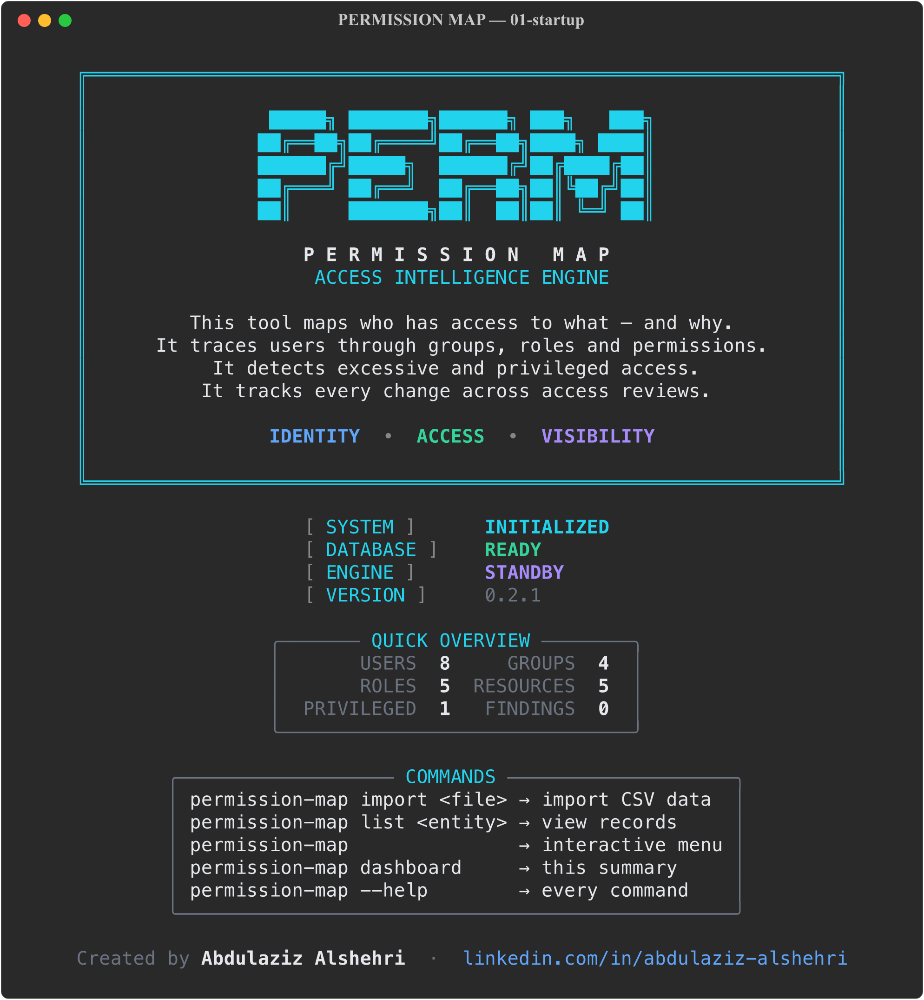
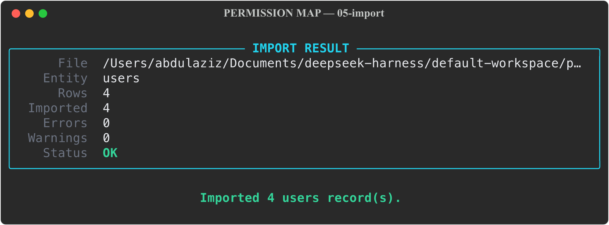
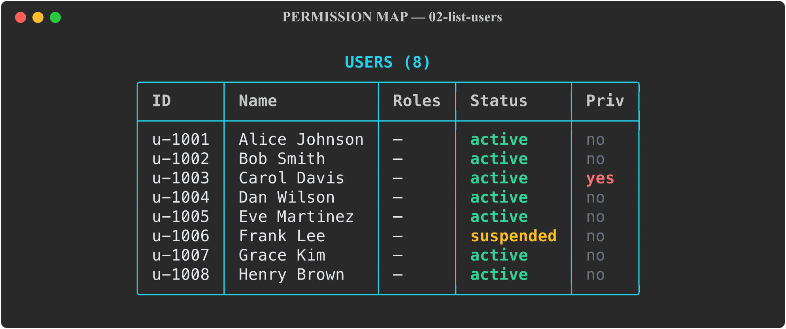
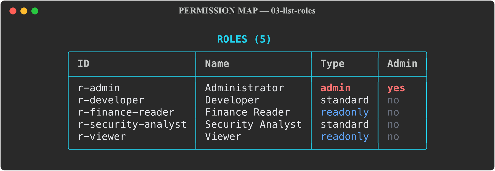
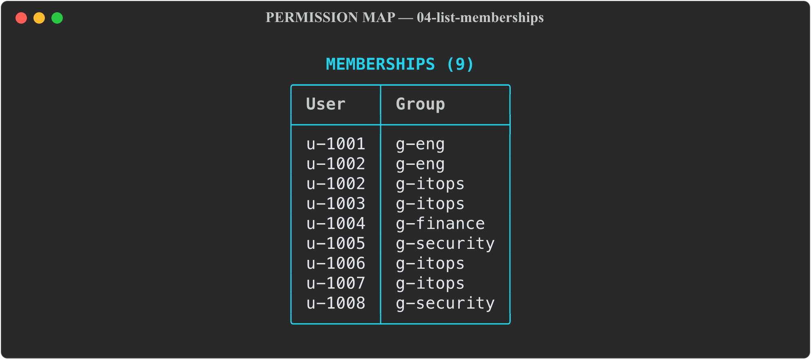
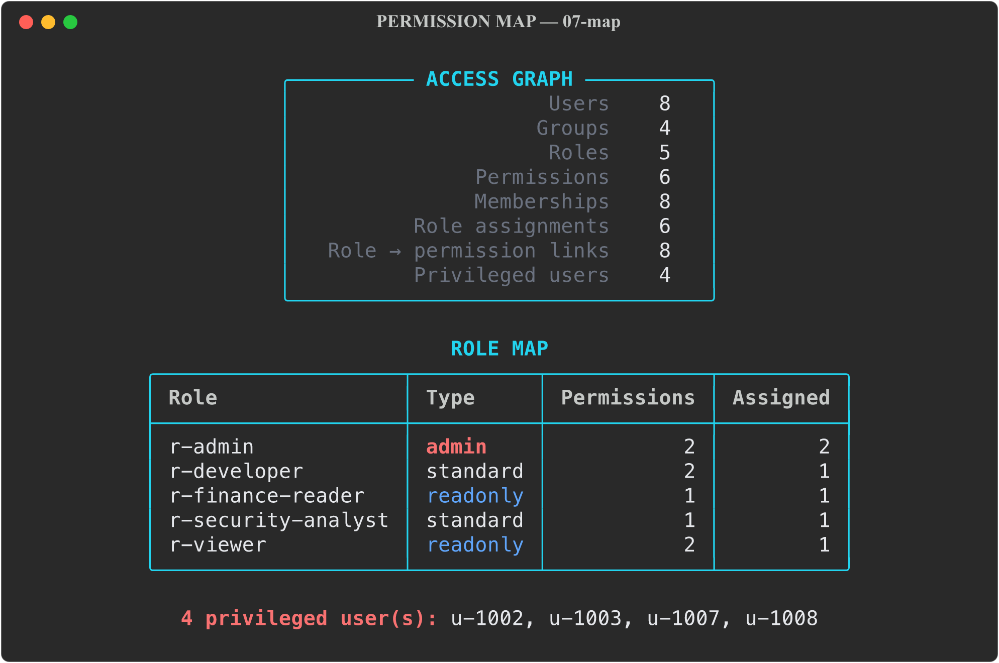
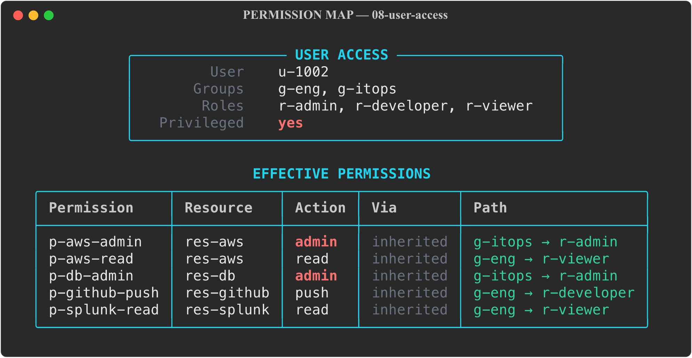
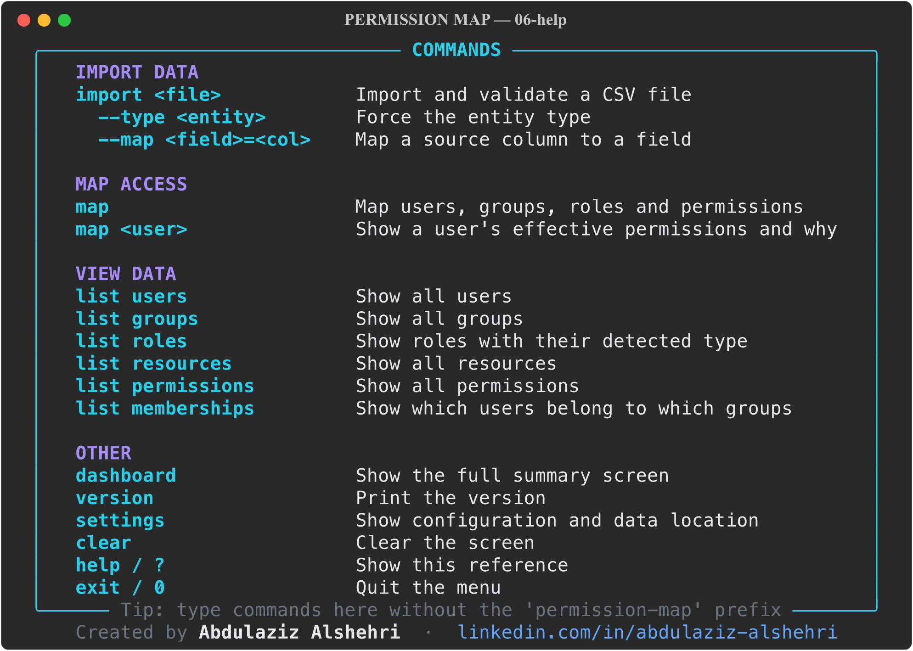

# PERMISSION MAP

[](https://github.com/azoz70/permission-map/actions/workflows/tests.yml)
[](https://www.python.org/)
[](LICENSE)

**Local-first access intelligence & review engine.**

PERMISSION MAP analyzes access permissions, maps relationships between users,
groups, roles, resources and permissions, identifies excessive privileges, and
tracks permission changes across access reviews — entirely on your machine. No
cloud, no subscriptions, no telemetry.

> Who has access to what? Why does this user have this permission? Which users
> have excessive privileges? Which permissions changed, and which need review?

---

## Highlights

- **Identity mapping** — connect users → groups → roles → permissions → resources.
- **Permission analysis** — direct vs. inherited access, privileged accounts,
  duplicates, unusual combinations.
- **Change intelligence** — compare two access snapshots and surface added,
  removed and changed permissions with severity and reason.
- **Risk detection** — an extensible rule engine with explainable findings.
- **Access review** — record approve / reject / investigate decisions with an
  auditable history.
- **Reporting** — HTML, CSV, JSON and summary reports.
- **Beautiful CLI** — a branded terminal experience with a fixed block-letter
  logo, an interactive menu, panels, tables and a live dashboard, powered by
  Typer + Rich.

## Screenshots

### Startup dashboard


### Import with validation


### Users with their effective roles


### Roles with automatic type detection


### User → group memberships


### Access map — who has access, and why


### One user's effective permissions and grant paths


### Command reference


> Regenerate with `python scripts/make_screenshots.py`.

## Technology

Python 3.12 · Typer · Rich · SQLite · Pydantic · Pandas · NetworkX · PyYAML ·
Pytest.

## Quick start

```bash
git clone https://github.com/azoz70/permission-map.git
cd permission-map

python3.12 -m venv .venv
source .venv/bin/activate
pip install -e ".[dev]"

permission-map            # interactive menu (brand banner + actions)
permission-map map        # who has access to what, and why
permission-map --help     # all commands
```

The first run initializes a local SQLite database under `~/.permission-map`
(override with `PERMISSION_MAP_DATA_DIR`).

## Project structure

```
permission-map/
├── permission_map/
│   ├── cli/            # commands, dashboard, logos
│   ├── core/           # models, normalizer, graph engine
│   ├── analyzers/      # permission analysis, risk rules, change detection
│   ├── database/       # SQLite schema & repositories
│   ├── importers/      # CSV / JSON / Excel importers
│   ├── reviewers/      # access-review workflow
│   ├── reporters/      # HTML / CSV / JSON reports
│   └── utils/          # config, validation, theme
├── examples/           # sample CSV files
├── tests/              # pytest suite
├── docs/               # architecture, data format, usage
└── pyproject.toml
```

## Roadmap

| Phase | Scope | Status |
| ----- | ----- | ------ |
| 1 | Project skeleton, CLI startup, fixed block-letter logo, interactive menu, dashboard, SQLite schema | ✅ done |
| 2 | CSV import + validation (column mapping, missing/invalid/duplicate/unknown-reference checks) | ✅ done |
| 3 | Mapping / graph engine (user → group → role → permission, effective access, grant paths) | ✅ done |
| 4 | Analysis & risk rules | ⏳ next |
| 5 | Snapshot comparison | ⏳ |
| 6 | Reporting (HTML/CSV/JSON) | ⏳ |
| 7 | Access review, Excel/JSON import, tests & release | ⏳ |

## Security

- Local-first: no external data transmission, no telemetry.
- Read-only analysis: external IAM systems are never modified.
- Imported files are parsed, never executed.
- All input is validated before it reaches the database.
- Exported reports are protected against CSV formula injection.
- No passwords or credentials are stored.

## Author

**Created by Abdulaziz Alshehri**

- LinkedIn: https://www.linkedin.com/in/abdulaziz-alshehri/
- GitHub: https://github.com/azoz70

## License

[MIT](LICENSE)
